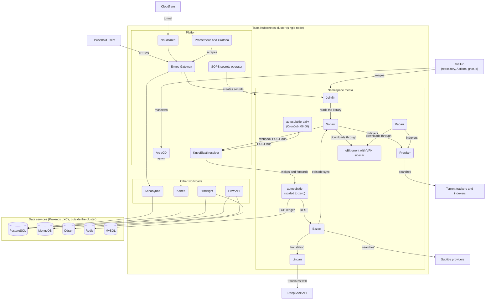

# Containers (C4 Level 2)

The apps, platform components and data services of the homelab and the integrations between them. Bootstrapped and last updated 2026-10-28 by spec-0015, which added the `autosubtitle` node and its edges. The external systems are the ones of [context.md](context.md).

