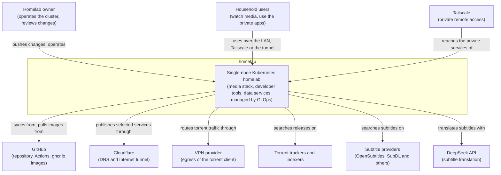

# System Context (C4 Level 1)

The homelab as one system: who uses it and the external systems it depends on. Its apps, databases and platform components are in [containers.md](containers.md). Bootstrapped and last updated 2026-10-28 by spec-0015.

