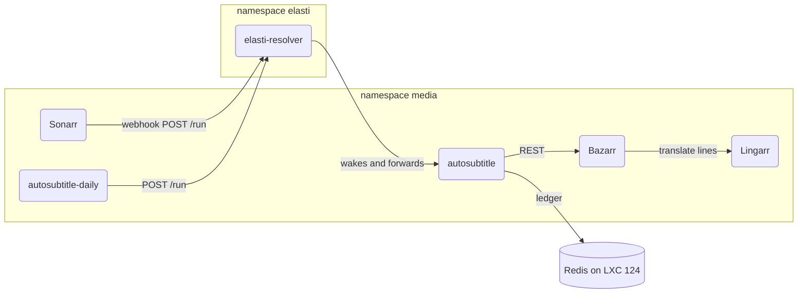

# Use cases

One document per use case, with its sequence diagram inline, under `flows/`.

| Use case | Module | Trigger | Entrypoint | Flow |
|---|---|---|---|---|
| Auto-translate subtitles of imported episodes | media | rest | `POST /run` | [auto-translate-imported-subtitles](flows/auto-translate-imported-subtitles.md) |

## Components

The `media` namespace gains `autosubtitle`, a worker scaled to zero by KubeElasti that Sonarr's webhook and a daily CronJob wake. Its contract is `docs/apps/autosubtitle/api.yaml` and its rollout is in `docs/autosubtitle.md`.

