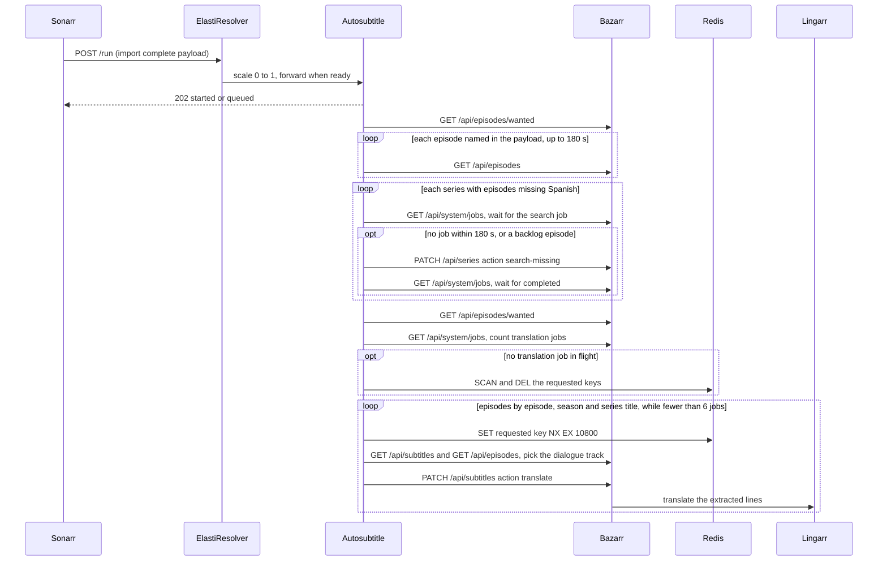

# Auto-translate subtitles of imported episodes

Sonarr calls the worker when it finishes importing or upgrading an episode, and a daily CronJob makes the same call with no body. KubeElasti holds the call, starts the worker from zero replicas and forwards it; the worker answers `202` and works in the background.

The run reads the episodes Bazarr lists as missing Spanish, waits for Bazarr's own search of each series to finish (or asks for it), and only then asks Bazarr to translate the English dialogue track of the episodes that still lack Spanish. Bazarr extracts the track and translates it through Lingarr; the worker never touches the media files or calls Lingarr itself. A Redis ledger records which episodes were requested, so no episode is requested twice.

## Rules

- **AC-1:** the worker has 0 replicas at rest, starts on the first call and returns to 0 replicas 1800 seconds after the wake-up.
- **AC-2:** every call is answered `202` at once; one run executes at a time, and exactly one more run follows when a call arrived during a run.
- **AC-3:** only episodes Bazarr lists as missing Spanish are processed; an episode named in a call but unknown to Bazarr is waited for up to 180 seconds.
- **AC-4:** for an episode named in a call, Bazarr's own search job is awaited, and the search is requested only after 180 seconds without one; for any other episode the search is requested at once, once per series per run.
- **AC-5:** translation is considered only after the search for the episode's series has completed and the episode still lacks Spanish.
- **AC-6:** the translated track is the English text track whose title has neither "signs" nor "songs", preferring a title with "dialog", "dialogue" or "full" and otherwise the first in track order.
- **AC-8:** an episode with a ledger entry, or already holding Spanish, is not requested again; the ledger entries are cleared whenever Bazarr holds no translation job, so a failed episode is requested again by the next run.
- **AC-9:** episodes are ordered by episode number, then season, then series title; a run submits only while fewer than 6 translation jobs are pending or running in Bazarr.
- **AC-12:** the daily CronJob makes the same call at 06:00, so the backlog drains without a new import.

## Errors

| Condition | Behavior | code | HTTP |
|---|---|---|---|
| Bazarr unreachable or rejects the API key | the run ends and changes nothing; the next run retries | `BAZARR_UNAVAILABLE` | none, the call was already answered `202` |
| Redis unreachable | the run still awaits Bazarr's searches but requests no translation, because duplicates could not be ruled out | `REDIS_UNAVAILABLE` | none, the call was already answered `202` |
| An episode named in a call is unknown to Bazarr after 180 seconds | the episode is skipped in this run | `EPISODE_NOT_KNOWN` | none |
| The MKV has no English text track, or only image-based ones | no request is made | `NO_TRANSLATABLE_TRACK` | none, Bazarr answers `415` for image-based tracks |
| Bazarr refuses the translate action (`409` or `502`) | the ledger entry is removed so a later run requests it again | `TRANSLATE_REJECTED` | none |
| The call carries a body that is not valid JSON | the body is ignored and the run starts | none | `202` |

## Response

`POST /run` answers `202` with a small JSON body saying whether a run started or was queued behind the current one. `GET /healthz` answers `200` and is the readiness check KubeElasti waits on before forwarding a held call.
